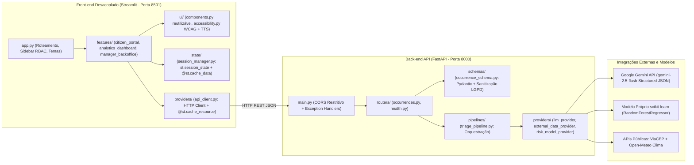

# ZelaAI — Plataforma de Zeladoria Urbana, Acessibilidade e Resiliência Climática

> **FIAP — Global Solution 2026/2 | Disciplina: Front-End em Sistemas de IA**
> Solução **CitizenTech** de ponta a ponta que conecta relatos de cidadãos a um back-end **FastAPI**, **Modelo Preditivo Próprio (`scikit-learn`)**, **Dados Abertos em Tempo Real (ViaCEP + Open-Meteo)** e **Inteligência Artificial Generativa (Google Gemini 2.5 Flash)** com saída estruturada (**Pydantic**) e validação **Human-in-the-Loop**.

---

## Sumário
1. [Problema Real, Público Afetado e Fontes de Dados](#1-problema-real-público-afetado-e-fontes-de-dados)
2. [Conexão com os ODS da ONU (ODS 11 e ODS 13)](#2-conexão-com-os-ods-da-onu-ods-11-e-ods-13)
3. [Fluxo CitizenTech Ponta a Ponta e Arquitetura](#3-fluxo-citizentech-ponta-a-ponta-e-arquitetura)
4. [Decisões Técnicas Justificadas](#4-decisões-técnicas-justificadas)
5. [Acessibilidade Universal e Cuidados WCAG Aplicados](#5-acessibilidade-universal-e-cuidados-wcag-aplicados)
6. [Ética, Privacidade (LGPD) e Limites da IA](#6-ética-privacidade-lgpd-e-limites-da-ia)
7. [Evidências de Validação (Testes com Pessoas e Casos de Teste da IA)](#7-evidências-de-validação)
8. [Diferenciais Competitivos Implementados](#8-diferenciais-competitivos-implementados)
9. [Instruções de Instalação, Execução Local, Testes (`pytest`) e Docker](#9-instruções-de-instalação-execução-e-docker)

---

## 1. Problema Real, Público Afetado e Fontes de Dados

### A Dor Concreta do Cidadão
Nas metrópoles brasileiras, problemas cotidianos de zeladoria urbana, falta de acessibilidade e eventos microclimáticos extremos afetam diretamente a segurança e o direito de ir e vir da população: bueiros obstruídos antes de tempestades, calçadas quebradas que bloqueiam cadeirantes e idosos, árvores com risco de queda sobre a rede elétrica e falhas de iluminação pública.

Nos canais tradicionais de atendimento municipal (como o Portal 156):
1. **Barreira de Usabilidade e Jargão Burocrático:** O cidadão precisa adivinhar entre dezenas de subcategorias técnicas qual secretaria atende sua demanda.
2. **Ausência de Contexto Climático em Tempo Real:** Um relato de "bueiro entupido" registrado durante uma tempestade de 20 mm/h em frente a uma escola pública tem criticidade completamente diferente de uma manutenção preventiva em dia seco.
3. **Falta de Orientação Imediata ao Cidadão:** Os sistemas tradicionais apenas geram um número de protocolo, sem devolver orientações práticas de autoproteção e segurança enquanto a prefeitura não chega ao local.

### Público Afetado
- **Cidadãos Urbanos em Geral**, com foco prioritário em **pessoas com deficiência ou mobilidade reduzida (cadeirantes, cegos), idosos**, comunidades em áreas suscetíveis a alagamentos e frequentadores de equipamentos críticos (escolas e unidades de saúde).
- **Gestores Públicos Municipais e Agentes da Defesa Civil**, que precisam de triagem estruturada e priorizada por risco real.

### Fontes que Sustentam o Problema
- **Relatórios de Atendimento SP156 / Ouvidorias Municipais:** Serviços de manejo arbóreo, tapa-buraco/calçadas, iluminação e limpeza de bocas de lobo figuram historicamente entre as 5 maiores demandas dos cidadãos paulistanos, somando centenas de milhares de chamados anuais.
- **CEMADEN (Centro Nacional de Monitoramento e Alertas de Desastres Naturais) & IBGE:** Mais de 8 milhões de brasileiros vivem em áreas mapeadas com risco hidrológico ou geológico (alagamentos, enxurradas e deslizamentos), onde a obstrução da drenagem urbana agrava desastres.
- **Censo IBGE / Pesquisa Nacional de Saúde (PNS):** O Brasil possui mais de 18 milhões de pessoas com algum tipo de deficiência; estudos de mobilidade urbana apontam que a precariedade de calçadas e ausência de rampas são o principal obstáculo físico à inclusão cidadã.

---

## 2. Conexão com os ODS da ONU (ODS 11 e ODS 13)

| ODS | Meta Relacionada | Como o ZelaAI Contribui Concretamente |
| :--- | :--- | :--- |
| **ODS 11 — Cidades e Comunidades Sustentáveis** | **Metas 11.2, 11.5 e 11.7:** Proporcionar acesso a sistemas de transporte e espaços públicos seguros, acessíveis e inclusivos, especialmente para pessoas em situação de vulnerabilidade, mulheres, crianças, pessoas com deficiência e idosos. | Prioriza automaticamente relatos que envolvem barreiras arquitetônicas (calçadas destruídas, rampas bloqueadas, falta de piso tátil) e entorno escolar/hospitalar, além de oferecer interface acessível sem jargão técnico, com **Modo de Alto Contraste**, **Texto Ampliado** e **Leitura em Voz Alta**. |
| **ODS 13 — Ação Contra a Mudança Global do Clima** | **Meta 13.1:** Reforçar a resiliência e a capacidade de adaptação a riscos relacionados ao clima e às catástrofes naturais. | Cruza automaticamente o CEP do relato com a **API meteorológica Open-Meteo em tempo real**, elevando a criticidade de ocorrências de drenagem/risco arbóreo quando há precipitação ativa e fornecendo instruções imediatas de autoproteção da Defesa Civil. |

---

## 3. Fluxo CitizenTech Ponta a Ponta e Arquitetura

### Fluxo da Solução
1. **Entrada do Cidadão (`frontend/features/citizen_portal.py`):** O cidadão descreve o ocorrido com suas palavras, informa o CEP e o perfil de pessoas afetadas no local (com validação prévia de tamanho, formato e upload opcional de evidência).
2. **Processamento Inteligente no Back-end (`backend/app/`):**
   - O front-end **nunca** chama o LLM diretamente; envia uma requisição HTTP REST `POST /api/v1/occurrences/triage` ao **FastAPI**.
   - O FastAPI sanitiza a entrada e aplica **anonimização automática LGPD** (mascarando CPFs e e-mails acidentais).
   - O provedor `external_data_provider.py` consulta a **API ViaCEP** (rua/bairro) e a **API Open-Meteo** (chuva em mm e temperatura atual).
   - O provedor `risk_model_provider.py` executa um modelo **`RandomForestRegressor` (`scikit-learn`)** para calcular um **Índice de Gravidade no Local (0 a 100)**.
   - O provedor `llm_provider.py` envia todo esse contexto enriquecido ao **Google Gemini (`gemini-2.5-flash`)** exigindo retorno estrito em JSON Schema validado pelo modelo Pydantic `StructuredAiTriageOutput`.
3. **Resposta Acionável e Human-in-the-Loop:**
   - O cidadão recebe um painel visual com **Indicador Semântico de Prioridade** (`[PRIORIDADE CRÍTICA]`, `[PRIORIDADE ALTA]`, `[PRIORIDADE MÉDIA]`, `[PRIORIDADE BAIXA]`), orientações imediatas de segurança (com botão **Ouvir Orientação em Áudio**), justificativa clara do encaminhamento e a seção **Conferência e Confirmação da Solicitação** (*Human-in-the-Loop*), onde pode confirmar ou corrigir a área/prioridade antes de emitir o **Protocolo Oficial (`ZC-OFICIAL-...`)**.

### Diagrama de Arquitetura em Camadas



---

## 4. Decisões Técnicas Justificadas

1. **Por que Streamlit no Front-end?**
   - Permite construir uma interface responsiva e centrada no cidadão utilizando *tabs*, *colunas*, *sidebar* de perfil de acesso, indicadores (`st.metric`) e integração nativa com gráficos interativos **Plotly**.
   - Oferece controle explícito de performance através de `st.session_state` (mantendo o histórico de solicitações vivo entre interações), `@st.cache_data` (evitando reprocessar catálogos, DataFrames e health-checks a cada *rerun*) e `@st.cache_resource` (reutilizando a configuração do cliente HTTP).
2. **Por que Google Gemini 2.5 Flash + Saída Estruturada Pydantic + Contingência Local?**
   - O modelo `gemini-2.5-flash` oferece baixa latência, camada gratuita acessível (*Google AI Studio*) e suporte nativo a *Structured Outputs* (`responseSchema` JSON).
   - A validação dupla com **Pydantic (`StructuredAiTriageOutput`)** no back-end garante que o front-end jamais receba um "dump de texto livre" ou um JSON malformado.
   - Para máxima resiliência acadêmica e de produção, implementamos também um **Motor Semântico Determinístico de Contingência** acoplado ao modelo `RandomForestRegressor` (`scikit-learn`), garantindo funcionamento 100% estruturado mesmo em ambientes sem chave de API ou sem acesso externo.
3. **Por que Docker + Variáveis de Ambiente para Deploy?**
   - A conteinerização com `backend/Dockerfile`, `frontend/Dockerfile` e `docker-compose.yml` garante reprodutibilidade exata com um único comando (`docker compose up --build`), enquanto a parametrização via `API_BASE_URL` permite hospedar o front-end no *Streamlit Community Cloud* e a API no *Render*.

---

## 5. Acessibilidade Universal e Cuidados WCAG Aplicados

Seguindo as diretrizes **WCAG 2.1 (Níveis AA e AAA)** e os requisitos da **Seção 3.5**, aplicamos os seguintes cuidados verificáveis no código (`frontend/ui/accessibility.py` e `frontend/ui/components.py`):

- [x] **Tela Inicial de Acessibilidade (Onboarding Inclusivo):** Ao acessar o sistema, a plataforma apresenta em primeiro plano três cartões de leitura (`1. Visualização Padrão`, `2. Letras Ampliadas`, `3. Alto Contraste + Letras Ampliadas`) acompanhados de instrução em voz alta, mais botão fixo no cabeçalho (`Alterar Modo de Leitura / Acessibilidade`).
- [x] **Independência de Cor (Critério WCAG 1.4.1):** Nenhum estado de criticidade ou erro depende apenas de cor. Todos os indicadores semânticos (`render_semantic_urgency_badge`) combinam **Tag textual explícita em colchetes (`[PRIORIDADE CRÍTICA]`, `[PRIORIDADE ALTA]`, `[PRIORIDADE MÉDIA]`, `[PRIORIDADE BAIXA]`) + Descrição da situação + Prazo de referência + Borda lateral de alto contraste**.
- [x] **Linguagem Simples e Ausência de Jargão Técnico (Critério 3.1.5 / Seção 3.5):** O Portal do Cidadão exibe exclusivamente os campos de preenchimento e os relatos registrados, deixando métricas técnicas de prioridade e gravidade restritas à Central do Gestor.
- [x] **Modo de Alto Contraste WCAG AAA (Critério 1.4.6):** Aplica fundo preto absoluto (`#000000`), tipografia branca (`#FFFFFF`) e bordas amarelas vibrantes (`#FFD600` — razão de contraste > 14:1).
- [x] **Escala Tipográfica Ajustável (Critério 1.4.4):** O modo `Letras Ampliadas` aumenta toda a tipografia da interface e ativa botões de apoio em áudio no preenchimento e leitura de relatos.
- [x] **Leitura em Voz Alta Nativa — Text-to-Speech (Critério 1.2 / Inclusão Digital):** Botões `🔊 Ouvir em Áudio` integrados à tela inicial, às etapas do formulário, aos exemplos, às orientações de segurança e aos cartões de relatos (*Web Speech API* `pt-BR`).
- [x] **Foco Visível e Cursores Semânticos (Critério 2.4.7):** Estilização explícita de `:focus-visible` e cursores de ponteiro em todos os elementos interativos.

---

## 6. Ética, Privacidade (LGPD) e Limites da IA

### Riscos Mapeados
- **Erro de Classificação ou Subestimação de Risco:** Um relato ambíguo pode fazer com que o modelo atribua prioridade menor do que a necessária.
- **Alucinação em Instruções:** Modelos generativos puros poderiam sugerir ações perigosas (como tentar desentupir um bueiro durante uma enchente).
- **Exposição de Dados Pessoais (LGPD):** Cidadãos frequentemente digitam números de CPF ou e-mail no corpo livre do relato.

### O que a Solução NÃO Faz (Limites Claros)
1. **Não substitui serviços de emergência médica ou salvamento imediato (193 / 192 / 199):** Em situações de risco iminente à vida, a interface orienta explicitamente o acionamento telefônico imediato do Corpo de Bombeiros ou Defesa Civil.
2. **Não executa despacho irreversível sem supervisão humana:** A IA atua como apoio de triagem e priorização, nunca como decisor autônomo final sem revisão humana.

### Como a Arquitetura e o Human-in-the-Loop Mitigam os Riscos
- **Duplo Human-in-the-Loop:**
  1. **Validação pelo Cidadão:** Antes de emitir o protocolo oficial, o cidadão confere a classificação sugerida, pode **alterar a área de atendimento ou o nível de prioridade** caso discorde e avalia se as orientações foram úteis.
  2. **Revisão pelo Gestor Municipal (RBAC):** Na aba *3. Central do Gestor*, o servidor municipal revisa os protocolos, pode reclassificar a prioridade operacional e emite a instrução para a equipe de campo.
- **Sanitização e Anonimização Automática LGPD (`occurrence_schema.py`):** Expressões regulares detectam e mascaram automaticamente números de CPF (`[CPF PROTEGIDO - LGPD]`) e e-mails (`[EMAIL PROTEGIDO - LGPD]`) antes de qualquer envio ao provedor externo.

---

## 7. Evidências de Validação

### 7.1. Testes de Usabilidade com Pessoas (Roteiro, Observações e Ajustes)

Aplicamos um roteiro estruturado de validação com **3 perfis representativos** (solicitar o registro de uma ocorrência urbana, interpretar a orientação de segurança, usar um filtro no gráfico e confirmar o protocolo):

| Participante | Perfil | Observações Durante o Teste | Ajuste Realizado na Solução a partir do Feedback |
| :--- | :--- | :--- | :--- |
| **Pessoa 1 (M. S., 64 anos)** | Moradora de bairro residencial; baixa familiaridade com termos técnicos e dificuldade para ler textos pequenos. | Apontou que siglas técnicas confundiam a leitura e que o campo para relatar o ocorrido deveria ser o primeiro item em destaque, com opção de ouvir a resposta. | **1.** Colocamos **"1. Descreva o Ocorrido"** em primeiro plano no formulário, removendo todo jargão técnico e emojis.<br>**2.** Criamos os controles `Texto Ampliado` e `Ouvir Orientação em Áudio` (`ui/accessibility.py`). |
| **Pessoa 2 (R. L., 29 anos)** | Usuário cadeirante; utiliza sistemas de ouvidoria para reportar rampas e calçadas bloqueadas. | Observou que nos sistemas comuns sua reclamação de calçada cai como "manutenção geral de via" com prazo longo, sem considerar que há uma pessoa com deficiência impedida de passar. | Adicionamos o seletor **"Quem é mais afetado no entorno?"** (`VulnerabilityContext`), que eleva automaticamente o peso de gravidade e direciona para a **Secretaria da Pessoa com Deficiência** com prioridade `ALTA`/`CRITICA`. |
| **Pessoa 3 (C. A., 41 anos)** | Analista de operações / perfil gestor; avaliou a visão de gráficos e a fila de despacho. | Apontou que precisava cruzar rapidamente se os chamados críticos de alagamento estavam ocorrendo em locais onde realmente chovia no momento. | Criamos o **2º gráfico interativo Plotly (Relação entre Volume de Chuva mm e Gravidade por Bairro)** e o filtro rápido `Apenas locais com chuva` no painel de monitoramento (`analytics_dashboard.py`). |

### 7.2. Tabela de Casos de Teste da IA (Entrada, Saída Esperada, Saída Obtida e Ajuste)

| Caso | Entrada Informada (Relato + CEP + Contexto) | Saída Esperada (Pydantic) | Saída Obtida Inicialmente | Ajuste Técnico Realizado no Pipeline / Prompt |
| :---: | :--- | :--- | :--- | :--- |
| **CT-01** | **Relato:** *"Os dois bueiros da esquina estão entupidos de lixo e a água da chuva já invadiu a calçada da escola."*<br>**CEP:** `01310-100` \| **Contexto:** `ENTORNO_ESCOLAR_OU_SAUDE` | `official_category`: `DRENAGEM_E_ALAGAMENTO`<br>`urgency_level`: `CRITICA`<br>`estimated_sla_hours`: `4` | Classificou corretamente a categoria, mas em dias sem chuva momentânea na API meteorológica atribuía urgência `MEDIA`, ignorando o risco escolar. | Ajustamos o cálculo do `risk_model_provider.py` e as regras do pipeline para que a combinação de alagamento + entorno escolar/saúde garanta índice de gravidade elevado e urgência `CRITICA` (SLA 4h). |
| **CT-02** | **Relato:** *"A calçada cedeu formando um buraco fundo e a rampa de cadeirantes está quebrada na avenida."*<br>**CEP:** `04011-000` \| **Contexto:** `PESSOA_COM_DEFICIENCIA_OU_IDOSO` | `official_category`: `ACESSIBILIDADE_E_CALCADAS`<br>`urgency_level`: `ALTA` ou `CRITICA`<br>Órgão: `SMPED / Subprefeitura` | Termos de dano físico faziam a triagem oscilar entre `RISCO_ESTRUTURAL` e `ACESSIBILIDADE_E_CALCADAS`. | Refinamos o prompt e o vetor de palavras-chave de mobilidade (`cadeirante`, `rampa`, `calçada`, `piso tátil`) priorizando `ACESSIBILIDADE_E_CALCADAS` quando há contexto `PESSOA_COM_DEFICIENCIA_OU_IDOSO`. |
| **CT-03** | **Relato:** *"Uma árvore grande rachou após a ventania e os galhos estão pressionando a fiação elétrica com faíscas."*<br>**CEP:** `05409-000` \| **Contexto:** `NENHUMA_ESPECIFICA` | `official_category`: `RISCO_ESTRUTURAL_E_ARVORES`<br>`urgency_level`: `CRITICA`<br>Orientação: manter distância de 15m e acionar 193. | Retornava orientações genéricas sem especificar distância mínima de segurança da rede elétrica. | Incluímos diretriz explícita de segurança civil no prompt e no motor estruturado exigindo distância mínima de 15m e alerta de não tocar em cabos energizados. |

---

## 8. Diferenciais Competitivos Implementados (Seção 6 do Edital)

1. **Múltiplas Fontes de Dados Abertos Reais (`external_data_provider.py`):** Cruzamento automático do relato do cidadão com a **API ViaCEP** (logradouro, bairro, cidade) e com a **API Meteorológica Open-Meteo** (precipitação em mm, temperatura e condição climática em tempo real).
2. **Modelo Preditivo Próprio em Complemento ao LLM (`risk_model_provider.py`):** Integração de um modelo `RandomForestRegressor` (`scikit-learn`) que calcula um *Índice de Gravidade no Local (0 a 100)* combinando severidade semântica, precipitação em mm, vulnerabilidade local e presença de evidência fotográfica.
3. **Perfis de Acesso (Visão Cidadão vs. Visão Gestor Municipal):** Alternância de perfil com duplo *Human-in-the-Loop* (confirmação pelo cidadão no envio e revisão/despacho pelo gestor no backoffice).
4. **Testes Automatizados (`pytest`):** Suíte com **13 testes automatizados** (`backend/tests/`) cobrindo validação Pydantic, proteção LGPD, bloqueio XSS/SQLi, modelo `scikit-learn`, pipeline de triagem e tratamento de erros HTTP 502/504 da API sem precisar subir a interface.
5. **Acessibilidade Avançada (WCAG AAA + Web Speech TTS):** Modo de Alto Contraste, Texto Ampliado, Leitura em Voz Alta das orientações em português e foco por teclado.
6. **Pronto para Produção + Docker Compose:** Orquestração multi-container (`docker-compose.yml`) combinada com suporte a deploy distribuído por variável de ambiente.

---

## 9. Instruções de Instalação, Execução e Docker

### Inicialização Rápida em 1 Clique (Windows)
Para facilitar a avaliação do professor e o uso imediato, a pasta raiz do projeto conta com o inicializador automático **`Iniciar_ZelaAI.bat`**, que verifica o ambiente, sobe o **Back-end (FastAPI)** e o **Front-end (Streamlit)** simultaneamente e abre o navegador automaticamente.

### Pré-requisitos
- **Python 3.11+** (ou **Docker Desktop** caso opte por rodar via containers).
- *(Opcional)* Chave gratuita da **Google Gemini API** obtida em [Google AI Studio](https://aistudio.google.com/app/apikey). *Nota: Caso você não configure uma chave no `.env`, o sistema funciona integralmente utilizando seu motor semântico estruturado de contingência + modelo RandomForest.*

### Passo 1: Configurar Variáveis de Ambiente
Na raiz do projeto, copie o arquivo `.env.example` para `.env`:
```bash
cp .env.example .env
```
*(No Windows PowerShell: `Copy-Item .env.example .env`)*

### Opção A: Execução Manual via Terminal

1. **Instalar dependências:**
   ```bash
   pip install -r backend/requirements.txt
   pip install -r frontend/requirements.txt
   ```
2. **Executar a suíte de testes automatizados (`pytest`):**
   ```bash
   python -m pytest backend/tests -v
   ```
3. **Iniciar o Back-end FastAPI (Terminal 1):**
   ```bash
   python -m uvicorn backend.app.main:app --host 127.0.0.1 --port 8000 --reload
   ```
   - Documentação interativa Swagger disponível em: `http://localhost:8000/docs`
   - Health check disponível em: `http://localhost:8000/api/v1/health`
4. **Iniciar o Front-end Streamlit (Terminal 2):**
   ```bash
   python -m streamlit run frontend/app.py --server.port 8501
   ```
   - Acesse no navegador: `http://localhost:8501`

### Opção B: Execução Completa via Docker Compose (1 Comando)

Com o Docker em execução, basta rodar na raiz do projeto:
```bash
docker compose up --build
```
- **Front-end Streamlit:** `http://localhost:8501`
- **Back-end FastAPI:** `http://localhost:8000/docs`
